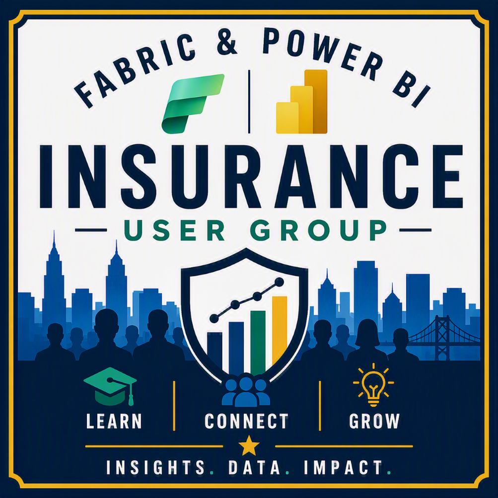

<p align="center"></p>

<h1 align="center">Fabric & Power BI Insurance User Group</h1>
<p align="center"><strong>Learn. Connect. Contribute. Grow.</strong></p>
<p align="center"><a href="https://community.fabric.microsoft.com/group/FabricandPowerBIInsuranceUserGroup"><strong>Join FPBIUG</strong></a> · <a href="https://www.linkedin.com/groups/34890033/"><strong>Connect on LinkedIn</strong></a> · <a href="docs/group-charter.md"><strong>Explore the Charter</strong></a></p>

---

## Welcome

The **Fabric & Power BI Insurance User Group** connects insurance professionals, data practitioners, analysts, architects, and AI innovators who are using Microsoft Fabric, Power BI, and related technologies to modernize insurance operations. FPBIUG is designed for practical learning, generous knowledge sharing, collaborative problem solving, real-world demonstrations, and professional growth.

> **User group focus:** FPBIUG is an educational technology community. Content does not provide legal, regulatory, compliance, audit, tax, or jurisdiction-specific insurance guidance.

## Live Program

| Experience | Schedule | What Members Can Expect |
|---|---|---|
| **Monthly User Group Meeting** | First Tuesday evening of each month at **6:00 PM Eastern Time** | Conference-quality speakers, practical demonstrations, curated Q&A, community announcements, and recognition |
| **User Group Office Hours** | **Coming Soon** | Informal problem solving, peer learning, troubleshooting, and connection |
| **Certification Cohorts** | Separate time-bound series, once launched, twice weekly for two to three weeks | Guided preparation for **PL-300, DP-600, and DP-700**, supported by official objectives and reputable learning resources |
| **Special Experiences** | Included in monthly programming or scheduled separately | Demo days, hands-on workshops, panels, Ask the Expert sessions, and community showcases |

## User Group Architecture

| Destination | Purpose |
|---|---|
| [Microsoft Fabric User Group](https://community.fabric.microsoft.com/group/FabricandPowerBIInsuranceUserGroup) | Official public home, event discovery, registration, and community participation |
| [LinkedIn Group](https://www.linkedin.com/groups/34890033/) | Professional networking, event amplification, announcements, and member connection |
| User Group Hub | Charter, governance, calendar standards, volunteering, recognition, and contribution pathways |
| Speaker Kit | Speaker recruitment, submission, preparation, recording choices, and presentation support |
| Event Content | Approved session resources, demos, captions, slides, YouTube metadata, and publication archives |

## Explore the Hub

- [User Group Charter](docs/group-charter.md)
- [Governance and Ownership](docs/governance.md)
- [Content and Accessibility Standards](docs/content-standards.md)
- [Program Portfolio](docs/program-portfolio.md)
- [Event Calendar Standards](calendar/README.md)
- [Speakers](speaker-directory/README.md)
- [Swag and Recognition](swag-program/README.md)
- [Volunteer Opportunities](volunteer-program/README.md)
- [Learning Resource Curation](resources/README.md)

## Leadership

FPBIUG is co-owned by Jennifer Ratten ([@jennratten](https://github.com/jennratten)) and Dean Jurecic ([@djurecic-wiiisdom](https://github.com/djurecic-wiiisdom)).

## Get Involved

```text
Discover → Join → Attend → Return → Engage → Contribute → Present → Champion
```

Members can begin by attending, asking a question, sharing a resource, joining a certification cohort, facilitating a discussion, volunteering for an event role, or submitting a session through **Sessionize**. The Sessionize URL is **Sessionize link coming soon** and should be replaced when the call-for-speakers page is published.

---

<p align="center"><strong>Learn. Connect. Contribute. Grow.</strong><br>Insights. Data. Impact.</p>
